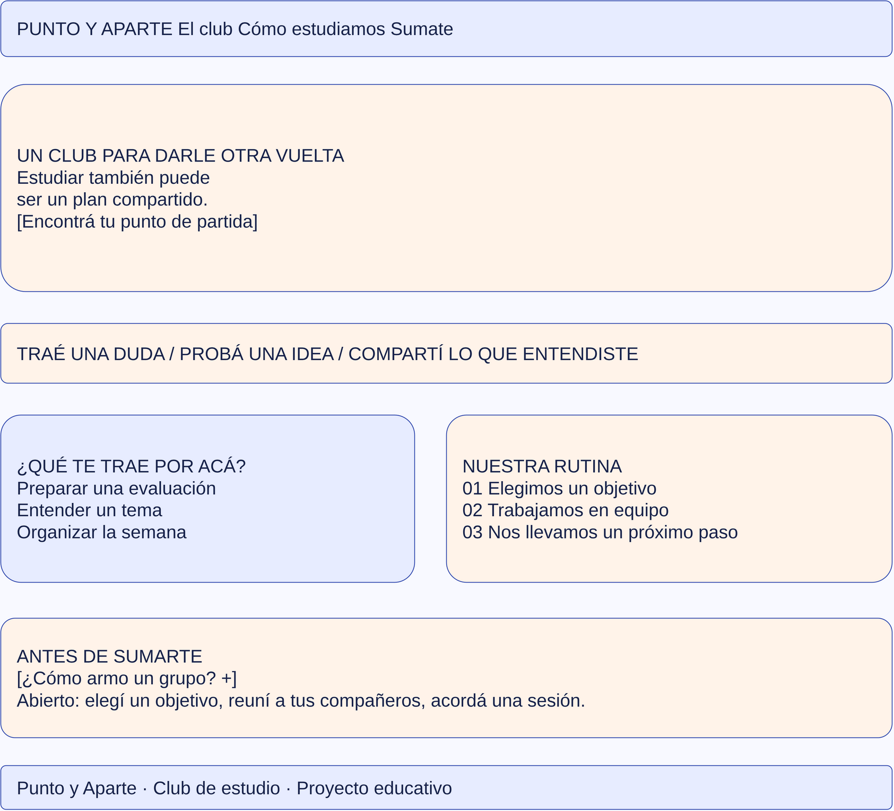
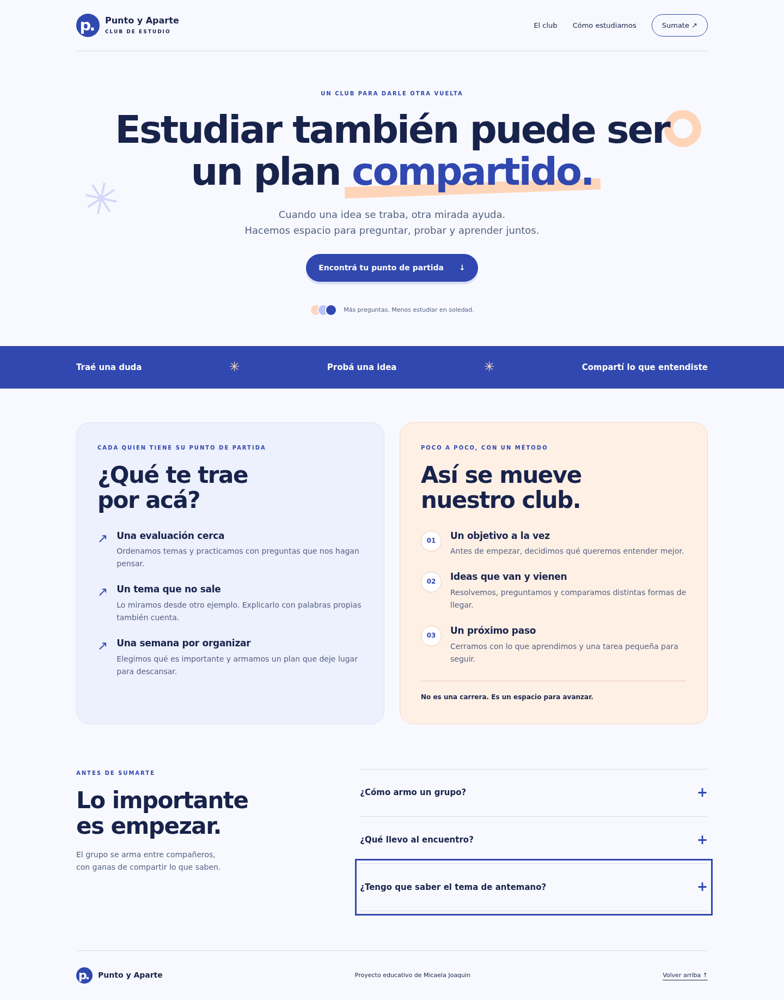
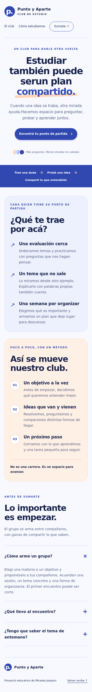

# Landing page — Club Punto y Aparte

## 🧩 Datos generales

| Campo | Detalle |
| --- | --- |
| Integrante 1 | Micaela Joaquin |
| Integrante 2 | No corresponde: trabajo individual |
| Modelos de IA utilizados | ChatGPT; GPT-6 Luna (revisión) |
| Tecnologías del proyecto | HTML5, CSS3, Markdown y GitHub |
| Link del repositorio | https://github.com/2023micaelajoaquin-droid/landing-page |

---

## 📄 Sketch

El boceto define la distribución antes de comenzar el código. En pantalla pequeña los bloques se ordenan en una sola columna.

## Planeamiento

Club Punto y Aparte: un espacio para preparar evaluaciones, destrabar dudas y organizar el estudio en compañía. Estilo gráfico con azul cobalto, durazno, fondo claro y títulos sans serif; botones redondeados y bloques de contenido bien separados. Los ejemplos son educativos y no ofrecen un servicio real de reservas.

## 💬 Prompts utilizados

### Prompt 1

> Creá una landing para Club Punto y Aparte en index.html y css/style.css, sin JavaScript. Usá el boceto como guía: cabecera, hero centrado, franja con tres acciones, dos bloques de contenido y preguntas desplegables al final. Título: «Estudiar también puede ser un plan compartido». El club reúne a compañeros para preparar evaluaciones, destrabar dudas y organizar la semana. Estética gráfica con azul cobalto #3048af, durazno #ffd5ba y fondo #f8f9ff, títulos sans serif grandes, botones redondeados y formas geométricas hechas con CSS. Usá details/summary para explicar cómo armar un grupo y qué llevar. Agregá navegación interna, enlace para saltar al contenido, foco visible y adaptación desde 320 px. No inventes horarios, direcciones ni inscripciones reales.

## Registro del proyecto

La primera versión contiene las secciones del boceto, tres desplegables nativos y navegación interna. La página no solicita datos personales ni confirma actividades o inscripciones.

Se comprobó en Chrome que los tres desplegables abren y cierran con Enter, que los enlaces apuntan a secciones existentes y que la página no contiene JavaScript. A 320, 375, 768 y 1280 px no hay desplazamiento horizontal accidental.

## Estado

- [x] Boceto previo al código.
- [x] Prompt registrado.
- [x] Interacción y vistas adaptables comprobadas.
- [x] Código guardado en el repositorio público de GitHub.

## Enlaces

[Repositorio](https://github.com/2023micaelajoaquin-droid/landing-page)

[Sitio del club](https://2023micaelajoaquin-droid.github.io/landing-page/)
